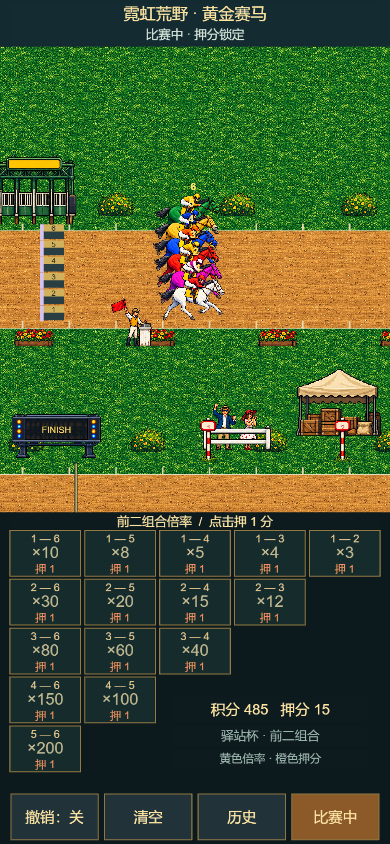
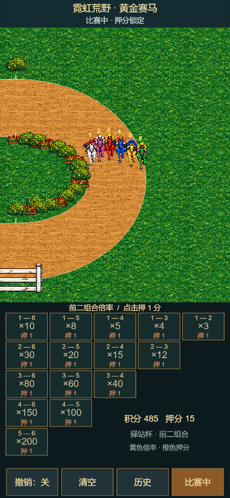
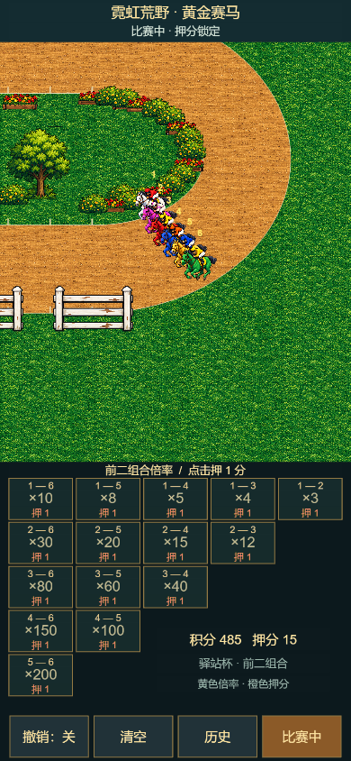

# 手机与r02素材运行验收

日期：2026-10-23。状态：本轮已在本地Creator实跑；不是原版完整1:1复刻验收。

本轮实现750×1334手机设计基准、上方持续比赛/下方三角倍率表、触控撤销/清空/历史/下一场、144帧马匹、独立正向号码、12类驿站道具和草地/泥地材质。只有一个弯道，向右出发、转弯、向左冲线；押分表在比赛中可见并锁定。

## 实际环境与来源绑定

- 本地工程：D:/code/shidai3/P4000/golden-horse-86；独立Git基线316d81d；运行源码、场景和资源哈希见[清单](mobile-r02-source-sha256.json)。版本Hook只改变版本/README镜像，不改变该运行内容。
- Creator 3.8.8，安装C:/ProgramData/cocos/editors/Creator/3.8.8；由Cocos-MCP/Dashboard启动。最终会话379ab6d4-7ed1-4f88-b5a2-6c5dddfb0dff；projectId 9d8a0041f7873b81；Preview http://192.168.31.100:7457。
- 入口db://assets/GoldenHorseGame.scene。固定UI经ui_build_tree及scene_apply_patch保存并重开，数组和组件引用保持。没有手工修改.scene/.prefab/.meta。
- 脚本经asset_refresh、script_wait_compile后，在同一Preview上执行MCP playtest；状态标记mobile-r02-144-crisp-v1、144帧、12类道具、7音效均读取到。Creator操作均经绑定本工程的CLI，没有操作其他项目MCP实例。
- 预览自身设备框曾保留393宽iPhone配置；最终流程使用官方WebpageFullScreen选项，并断言raceViewport宽度与浏览器窗口一致，排除设备框裁切导致的假通过。未手动控制桌面应用焦点，使用显式MCP资源刷新和编译证据。

## 结果

| 实际CSS窗口 | 完整比赛 | 最小触控高度 | 结果 |
|---|---:|---:|---|
| 390×844 | 连续3局 | 48.88px | 通过 |
| 360×640 | 1局及下一局 | 45.12px | 通过 |
| 430×932 | 1局及下一局 | 53.89px | 通过 |

五局均实际推进引擎时间，以真实触摸押分和开跑；未改时间、排名或结算。全部六马可见冲线顺序与结算相同，返分只执行一次，结算后继续离场，同一世界没有替换。新局押分与旧结果清空。两个边界手机尺寸另覆盖撤销开关、清空、历史展开及锁定后的押分拒绝。全部触控矩形至少44CSS像素且完整位于窗口内。

最终三个报告的consoleErrors、pageErrors、requestFailures、httpErrors均为0。汇总与逐步证据：[汇总](mobile-r02-summary.json)、[连续三局](mobile-three-rounds-result.json)、[360](mobile-360-result.json)、[430](mobile-430-result.json)。脚点与徽标边界、帧独立性、生命周期及已有核心/轨迹/离场测试、旧网页Smoke、strict检查通过。

场景验证器返回aggregate ok=false，不能描述为全绿：60项为系统字体Label未绑定FontAsset（实际_isSystemFontUsed=true），20项为21:39的Camera.color/Canvas.color废弃getter警告，被工具归为CONSOLE_ERROR。reopenable/componentsIntact/referencesValid检查为true；这些不是本轮Preview诊断的运行错误。原始结果另存[场景验证](mobile-r02-scene-validation.json)，未为消除提示修改P8000工具。

## 实录与直接截图

[100.9秒MP4](actual-mobile-r02-three-rounds.mp4)为实际Creator Preview Canvas录制，390×844，H.264；[原始VP8 WebM](actual-mobile-r02-three-rounds.webm)保留。MP4只做格式编码，保留实际时间和画面，不加速、不生成比赛。录像没有音轨，不能代表原版听感已验收。

截图为playtest从实际Preview直接采集，不是生成样图。更多结算、离场、手机边界和历史截图在evidence/mobile-r02。

## 审查与范围

实际reviewer会话/root/review_2d_runtime只读审查；发现的手机裁切、生命周期测试依赖、静态节点监听未解绑均修复并复审关闭。documentation-engineer会话/root/docs_mobile_assets仅更新了指定背景/美术Markdown。OCR使用Delegation Mode，主会话执行实际diff审查，记录见[审查](MOBILE_R02_REVIEW.md)。未使用独立GPT审查或新增审批流程。

固定赔率与随机名次模型保留；原机赔率生成、特殊奖励、原版音轨与逐像素一致性不在本轮已验证范围。尚未验收正式发布构建/产物Smoke。旧Main.scene与旧网页均不能用作本轮Creator运行证据；当前本地工程保存的活动入口为GoldenHorseGame.scene。未配置远端，交付为本地提交，不向父仓或GitHub推送源码。
