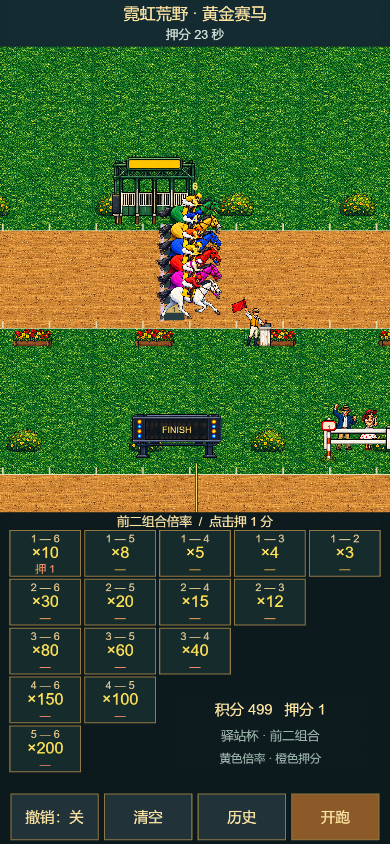
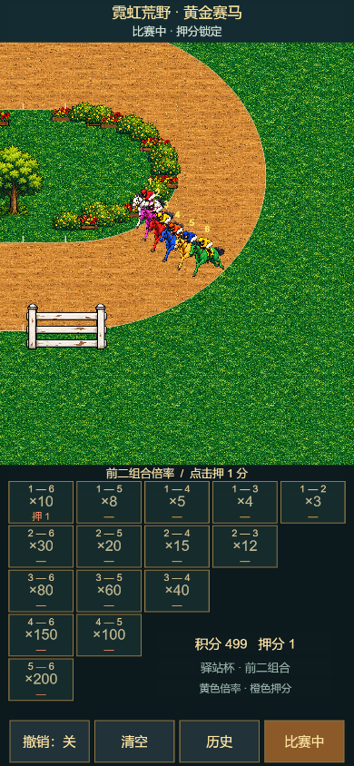
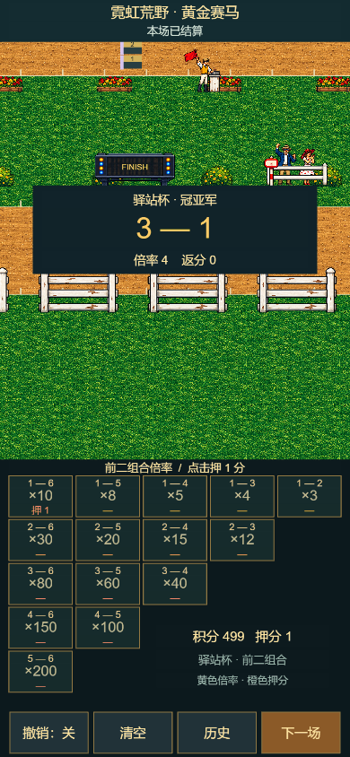
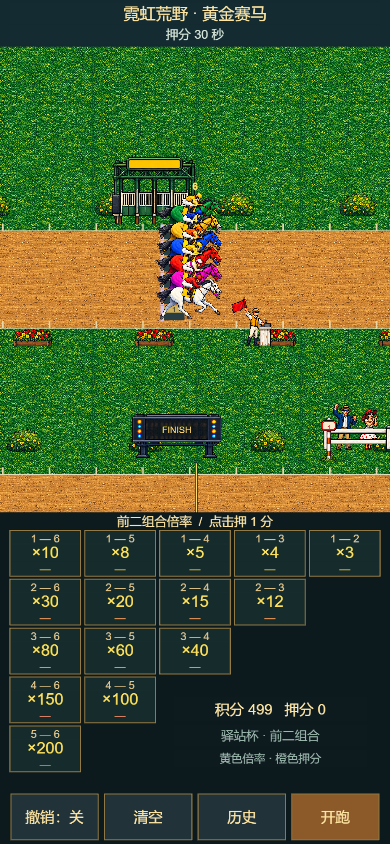

# Web Mobile 正式构建与本地产物 Smoke

日期：2026-10-23。状态：本地构建与390×844单局 Smoke通过；未发布，不代表完整原版复刻验收。

## 工程与产物绑定

- Owner：当前用户；Creator 3.8.8；工程 `D:/code/shidai3/P4000/golden-horse-86`，projectId `9d8a0041f7873b81`，会话 `379ab6d4-7ed1-4f88-b5a2-6c5dddfb0dff`。身份经 Companion project resolve / creator info核对；未操作其他工程。
- 源码基线 `099660e63c6a609b11760f7f02e41cef9ff55a1b`；本轮没有玩法代码修改。构建使用本地工作树，166个输入文件哈希见[源码清单](web-mobile-source-sha256.json)。原有未跟踪样稿、Creator metadata未混入本轮提交；本次证据不能表示干净检出即可完整重建。
- [构建配置](build-web-mobile.json)：web-mobile，debug=false，sourceMaps=false，竖屏，唯一启动及打包场景为 `GoldenHorseGame.scene`（UUID `22896837-e9c5-4efa-bb65-a1b7c45c273b`）。产物main配置也只有该场景，不含旧Main.scene。
- 构建操作 `horse-web-build-20261023-03`，15:10:35—15:11:11 UTC；Builder完成，Creator退出码36，Companion判定state=passed，见[构建结果](web-mobile-build-result.json)。输出为 `build/web-mobile/index.html`，不是 `preview-web/`。
- 产物packageHash：`286c88b3cadca37d895b08e658a6207af894571e5aed4ec010fdf04fd2d5c5df`。Smoke开始前由Companion重新校验整包哈希，使用独立浏览器会话与临时本机HTTP服务加载该产物。

## 构建失败与缓存恢复

前两次构建退出34，原因是三个既有h01样稿的六个library JSON含全零字节；单文件AssetDB refresh没有修复。第三次构建前将这六个派生缓存逐个备份到 `temp/creator-ai-bridge/corrupt-cache-backup/`，再经本工程AssetDB refresh刷新 `db://assets/resources/race/`。Creator重建缓存后，全library JSON解析检查无损坏项，构建通过。未改源PNG、场景、Prefab或meta。首次失败日志保存在 `temp/creator-ai-bridge/build-first-failed.log`；最终日志在同目录build.log。

CLI启动日志仍出现本机project.log/cache访问提示及metric警告，不能称所有编辑器日志无错误；通过结论来自Builder完成、退出码、产物身份和实际运行。产物页面诊断另列如下。

## 运行结果与限制

[Smoke步骤](build-smoke-mobile.json)与[原始结果](web-mobile-smoke-result.json)记录真实触摸和实际引擎时间，不改排名、时间或结算。共17步，16步执行成功，runtime_snapshot因正式产物没有测试桥而跳过；gameTestReady=false。结果里的截图source字段沿用工具通用名称preview，实际target为web-mobile-build，来源由outputDir和packageHash绑定。

- 390×844加载后显示500积分；触摸1—6组合后显示499积分、押1；触摸开跑后表格保留，显示押分锁定。
- 直道、唯一弯道正常显示；约29.5秒后截图显示结果3—1、倍率4、返分0，积分499；本次押分未命中。
- 等待7秒后六马已离场；触摸下一场后结果面板关闭、押分清零、倒计时回到30秒、六马回到起跑位置。
- diagnostics中的consoleErrors/pageErrors/requestFailures/httpErrors计数均为0。
- 通过截图人工核对流程；没有注册测试桥，没有在正式产物自动断言可见冲线顺序、胜出返分或单次结算。本轮仅一局、一个尺寸，不替代既有Preview多局证据或其他平台发布验收。音频听感未验收。

## 验证与审查

安装本地缺失的TypeScript 5.6.3后，npm test与strict typecheck通过；没有改package.json或生成lock文件。旧网页Smoke只作为既有回归，不能证明上述正式产物运行。

本轮code-mapper `/root/horse_map`完成只读定位；reviewer `/root/horse_build_review`先审配置与登记，再复核产物记录、166项源码哈希与全部七张截图，未发现确定缺陷。两者均有真实启动和返回；权限隔离未核验。OCR使用Delegation Mode，显式加载父仓共享规则，宿主审查本轮配置、说明与结果；范围外原有素材、meta和其他任务改动不计为已审。本轮未调用独立GPT审查。

OCR清单：产品total_files=28，reviewed_files=15（8个文本/JSON及7张人工查看的PNG），skipped_files=13（5个原有meta/服务配置及8张原有图片，均为范围外），全工作区coverage_rate=53.57%，本轮范围覆盖100%。父仓筛选后total_files=198，reviewed_files=2（仅根README中P4000两处及P4000/README），skipped_files=196（194项被过滤的无关改动及2个其他产品gitlink），全工作区coverage_rate=1.01%，本轮范围覆盖100%；未将目录读取警告当成子仓审查通过。逐项清单和规则输出保存在本机临时目录 `horse-web-mobile-review-20261023`，没有复制到产品仓。源码清单逐文件哈希复核未变化，构建配置哈希与build/smoke包哈希匹配。未发现本轮阻断问题。

剩余事项：远端与父仓submodule挂载、外置玩法JSON及校验、原版赔率/奖励/节奏/音轨与完整复刻校对。未创建远端、未发布站点。
